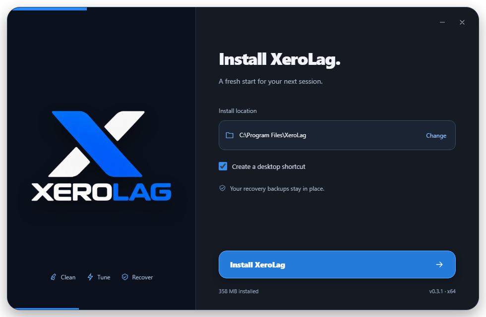

# Custom XeroLag setup

The public download is a single offline Windows x64 executable. Its frameless Electron interface uses the supplied XeroLag artwork, rounded corners, blue actions, keyboard focus, reduced motion and separate ready, installing, error and completion states. It has no network dependency.

Setup reads the existing machine-wide installation location before enabling installation. Users can choose another local folder and whether to create a desktop shortcut. A Start menu entry and Windows uninstaller are handled by the embedded NSIS engine. Existing recovery data is retained. Setup does not apply optimization profiles.

Before starting, the controller checks for a running XeroLag instance, linked destination directories, available disk space and the embedded engine's SHA-256 checksum. The install path is passed as the final literal `/D=` argument, without a command shell. Progress shows actual stages with an indeterminate installation indicator. Closing is disabled while Windows setup runs. Failures remain visible and can be retried; Windows restart requests are reported. Opening the installed app is an explicit action.

`installer/` contains the setup process, isolated preload bridge, controller, renderer and packaging configuration. `assets/installer/installer.nsh` integrates shortcut choice and uninstaller copy with the maintained [electron-builder NSIS engine](https://www.electron.build/v26/docs/nsis/). `scripts/prepare-installer.ps1` converts supplied branding into native uninstaller bitmaps. No third-party installer skin or remote installer content is loaded.

Run `npm run dist` to check source and tests, build the app's NSIS engine, hash it, package the custom setup and copy the final executable/checksum into `dist`. The engine and packaging intermediates remain under `.cache/package`; only the outer setup is distributed. Because setup embeds an interface runtime and the complete app payload, its download is larger than a plain native wizard.

`npm run test:installer` loads the real installer window and preload against a fake controller. It verifies the rounded shell, folder selection, shortcut choice, retry, progress, busy-close protection and explicit launch, and saves screenshots under `.cache/previews/installer`. Controller unit tests cover literal engine arguments, integrity rejection, failure/restart exit codes and existing-location initialization. A harmless compiled NSIS probe checks that a spaced destination reaches Windows setup intact; it only writes its observed argument inside the isolated test folder. The 72 automated tests and installer UI check pass. They never execute the application installer or change Windows settings.

The downloadable build remains unsigned. Its Windows administrator prompt is part of the executable manifest; development previews do not request elevation. Installing/uninstalling the resulting executable was not performed during these checks.
